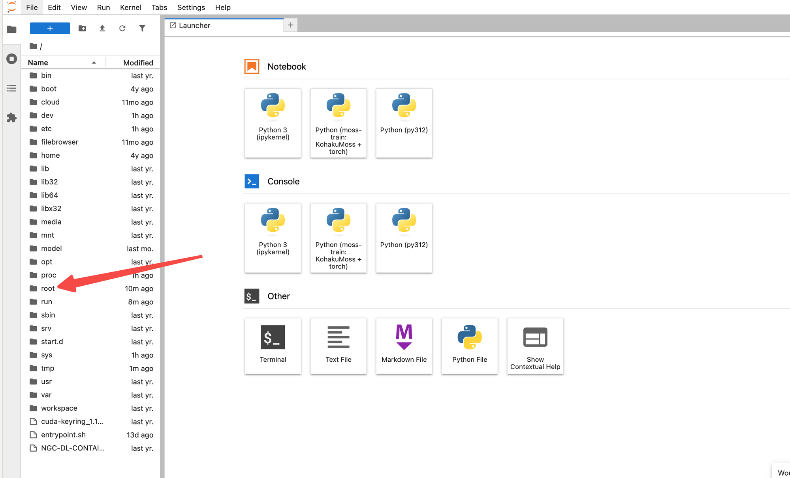
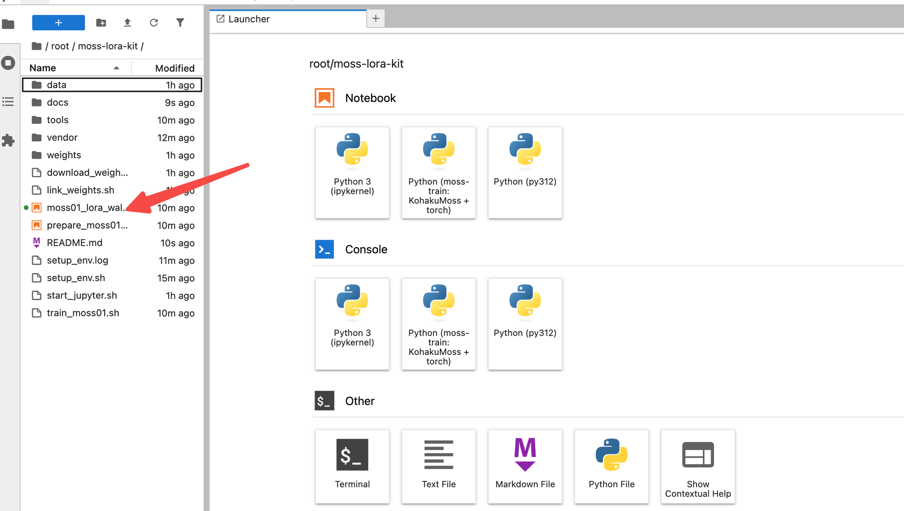
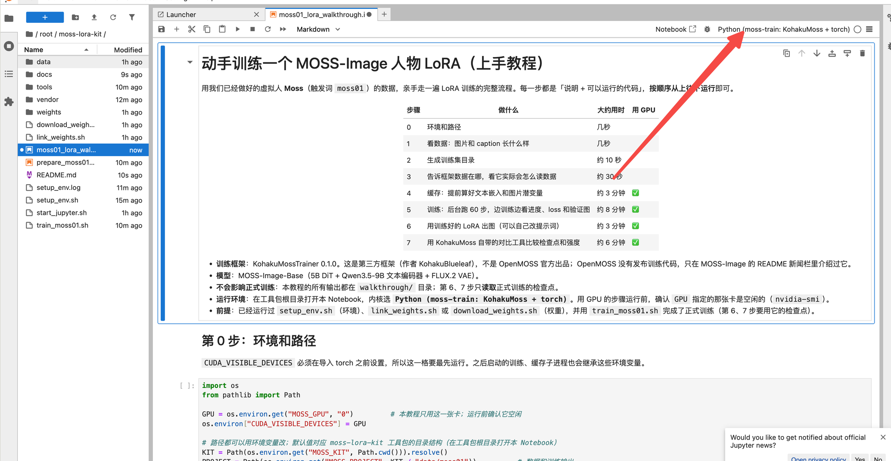

# moss-lora-kit：MOSS-Image 人物 LoRA 训练工具包

用 [MOSS-Image](https://github.com/OpenMOSS/MOSS-Image)（OpenMOSS，Apache-2.0）训练一个人物 LoRA 的完整流程：环境安装、数据整理、训练、边训练边看效果、出图对比。示例人物是虚构的 **Moss**（触发词 `moss01`）。

- 训练框架：[KohakuMossTrainer](https://github.com/KohakuBlueleaf/KohakuMossTrainer) 0.1.0（第三方，PyPI 包 `kohakumoss`）
- 模型：MOSS-Image-Base（bf16 DiT + Qwen3.5-9B 文本编码器 + FLUX.2 VAE），文本编码器训练时冻结。KohakuMoss 0.1.0 的训练需要 **HF 目录格式**的权重（`transformer/ text_encoder/ tokenizer/ vae/`），ComfyUI 打包的单文件格式只能用于推理
- 显卡：一张 24GB 以上的 NVIDIA 卡即可（实测 RTX 4090 48GB）

## 快速开始

### A. 在优云智算上用分享的镜像（环境已装好）

镜像里已经包含：Python 环境、KohakuMoss、示例数据、模型权重（`weights/MOSS-Image-Base/`，HF 格式，约 27GB），以及一次完整训练的结果（`data/moss01/runs/`）。

**打开教程：**

1. 用镜像创建实例（RTX 4090）。实例运行后，在控制台的实例列表里点这台实例的 **JupyterLab** 按钮，平台会自动带上访问令牌。

   

2. JupyterLab 打开后，左侧显示的是系统根目录 `/`。依次双击 **`root`** → **`moss-lora-kit`**，再双击 **`moss01_lora_walkthrough.ipynb`**。

   

   

3. 选择内核 **`Python (moss-train: KohakuMoss + torch)`**：弹出选择框时直接选；没有弹出的话，点 Notebook 右上角的内核名称切换。

   

4. 点第一个代码格子，按 **Shift + Enter** 运行并跳到下一格，从第 0 步开始往下运行。第 0 步显示 `使用 GPU 0` 和 GPU 占用情况，说明环境正常。

**正式训练**：先跑完教程第 0–5 步，再在 JupyterLab 里新建终端（File → New → Terminal），运行：

```bash
cd /root/moss-lora-kit && bash train_moss01.sh
```

单卡 1200 步，约 70 分钟。训练期间可以在教程第 5 步运行 `watch(OFFICIAL_RUN)` 实时看进度和验证图；训练完成后运行第 6、7 步出图、对比检查点。实例只有一张 GPU 时，**教程的小练习和正式训练不要同时运行**。

**不用控制台、从本机打开（可选）**：用 SSH 把实例的 8888 端口转发到本机，然后在浏览器打开 `http://localhost:8888/lab`，令牌是实例里的环境变量 `JUPYTER_TOKEN`：

```bash
ssh -p <端口> -N -L 8888:localhost:8888 root@<实例地址>
```

### B. 在一台新机器上从头装

```bash
cd moss-lora-kit
bash setup_env.sh               # Python 3.12 + torch(cu130) + KohakuMoss + Jupyter 内核，约 10 分钟
                                # 驱动较旧时：TORCH_CUDA=cu128 bash setup_env.sh
bash download_weights.sh        # 从 ModelScope 下载 MOSS-Image-Base 权重（HF 格式，约 27GB）
```

然后：

1. 运行 `prepare_moss01_for_lora.ipynb`：按 `data/moss01/source/selection.json` 生成训练集 `data/moss01/data/train/1_moss01/`（图片 + 同名 `.txt`），并做校验和统计。
2. 训练：`bash train_moss01.sh`（默认单卡 GPU 0，1200 步，约 1 小时；多卡：`GPUS=0,1,2 bash train_moss01.sh`，步数自动按卡数折算）。
3. 打开 `moss01_lora_walkthrough.ipynb` 一步一步体验，或直接用训练出的检查点出图。

## 目录结构

```
moss-lora-kit/
├── setup_env.sh                       # 安装环境
├── download_weights.sh               # 下载权重
├── train_moss01.sh                    # 生成配置 → 缓存 → 训练
├── start_jupyter.sh                   # 备用：机器上没有 JupyterLab 时用
├── prepare_moss01_for_lora.ipynb      # 生成训练集 + 校验
├── moss01_lora_walkthrough.ipynb      # 上手教程：看数据 → 训练（边训边看）→ 出图 → 对比
├── tools/
│   ├── build_*_notebook.py            # 两个 Notebook 的生成脚本
│   ├── nbcheck.py / justified_collage.py
│   └── dataset/                       # 制作数据集用的脚本：镜头清单、补拍清单、AI 预填建议、挑选页面
├── data/moss01/
│   ├── source/                        # 候选图（M01–M48 第一批、P01–P20 补拍）、清单、selection.json
│   ├── data/train/1_moss01/           # 生成的训练集（运行 prepare 后出现）
│   └── runs/moss01-lora/              # 训练输出：checkpoints/、samples/、metrics.jsonl、export/
├── weights/MOSS-Image-Base/           # 权重（HF 格式：transformer/ text_encoder/ tokenizer/ vae/）
└── vendor/kohakumoss-0.1.0/           # KohakuMoss 源码包（setup_env.sh 下载，含 configs/ scripts/）
```

## 用自己的数据

训练集格式：一个文件夹，每张图配一个同名 `.txt`，内容是这张图的描述（caption），以触发词开头：

```text
moss01, full-body portrait, side profile facing right, gazing out of a window, low bun hairstyle,
wearing school uniform: white blouse, dark green vest, plaid pleated skirt, knee socks, loafers,
candlelit dining hall, warm candlelight
```

caption 的原则：**会变的写进去**（构图、角度、表情、发型、服装、场景、光线），**不变的不写**（脸、眼睛、发色，交给触发词学习）；**按图的实际内容写**；同一个东西始终用同一种说法。

`tools/dataset/` 里有我们制作 Moss 数据集用的脚本：生成镜头清单、补拍清单，以及一个挑选页面（AI 预填建议，人工复核后导出 `selection.json`）。这些脚本按 `data/moss01/source/` 的目录结构编写，用于别的数据时需要相应调整。

## 训练出来怎么用

- **ComfyUI**（需要原生支持 MOSS-Image 的 master/nightly 版本）：
  ```bash
  cd vendor/kohakumoss-0.1.0 && ../../.venv/bin/kogine run scripts/export/export.py \
      --set WEIGHTS=../../weights/MOSS-Image-Base \
      --set ADAPTER=../../data/moss01/runs/moss01-lora/checkpoints/step_00000900/trainable.safetensors \
      --set FORMAT=comfy --set FUSED_QKV=True --set OUT=moss01.safetensors
  ```
  放进 `ComfyUI/models/loras/`，用自带的 LoRA 加载节点；采样 50 步、CFG 3（shift 默认 5）。
- **Python**：`kohakumoss.inference.MossPipeline.from_pretrained(权重目录, adapters=[(检查点, 1.0)])`，见教程第 6 步。

## 许可与说明

- MOSS-Image：Apache-2.0；KohakuMoss：KohakuMoss License 1.0。
- 示例数据由 Codex（gpt-image-2）以参考图生成，人物为虚构，仅供学习研究。服装和场景带有英伦寄宿学校（类似《哈利·波特》）风格，请勿用于商业用途。
- 已知问题：示例数据校服占 79%、朝左的角度少；训练后不写触发词时也会出现 Moss 的特征（泄漏），详见教程和文章。
