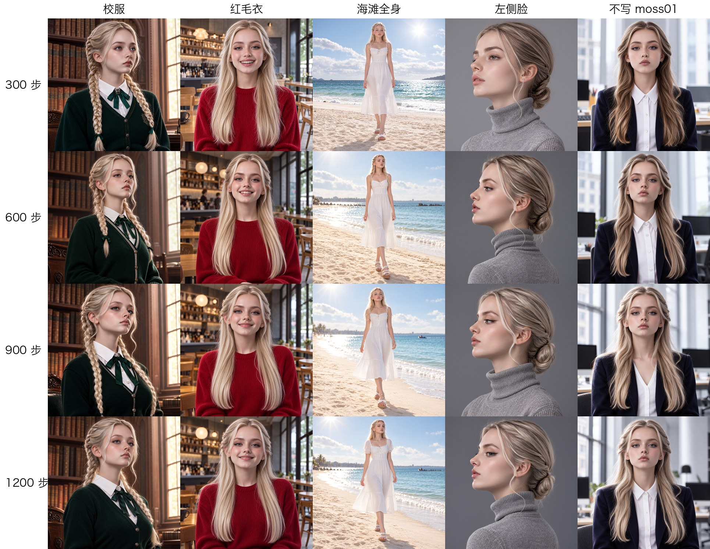
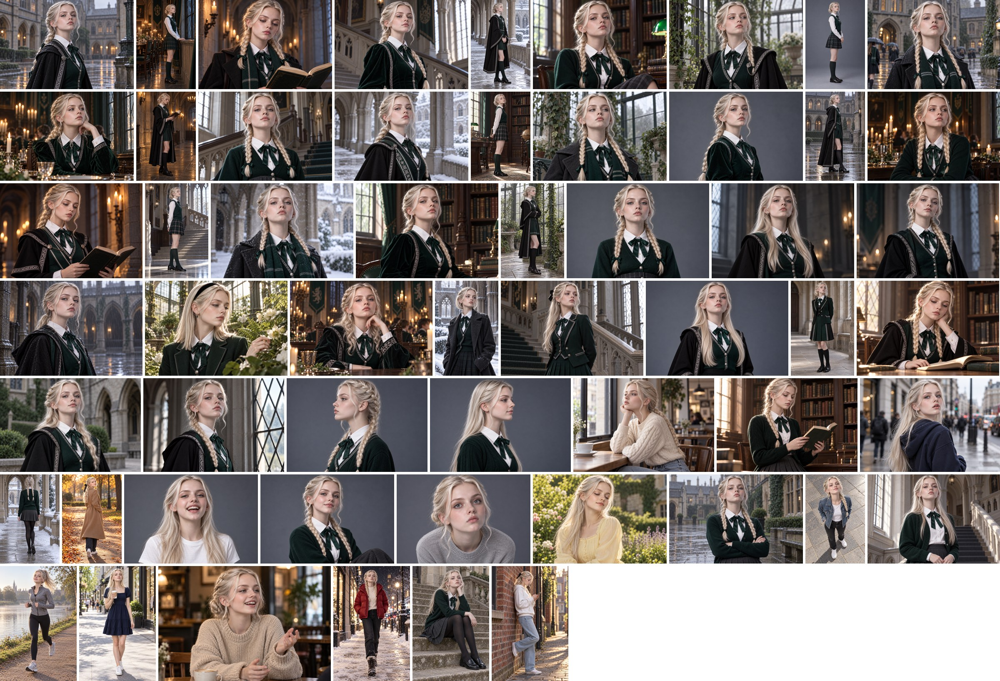

# moss-lora-kit：马尔福女友 · MOSS-Image 人物 LoRA 训练工具包

**简体中文** | [English](README.en.md) | [日本語](README.ja.md)

用 [MOSS-Image](https://github.com/OpenMOSS/MOSS-Image)（OpenMOSS，Apache-2.0）训练一个人物 LoRA 的完整流程：环境安装、数据整理、训练、边训练边看效果、出图对比。以「**马尔福女友**」为创作主题，示例人物是虚构的 **Moss**（触发词 `moss01`）。


**教程与镜像入口：** [阅读我的 X / 推特教程](https://x.com/MinLiBuilds/status/2114617833787470247?s=20) · [打开优云智算训练镜像](https://www.compshare.cn/images/DsDLGij1oUEb?referral_code=D8gyFELBBX7EvgT8sPgltW&ytag=GPU_YY_YX_X_shijiange1026)

- 训练框架：[KohakuMossTrainer](https://github.com/KohakuBlueleaf/KohakuMossTrainer) 0.1.0（第三方，PyPI 包 `kohakumoss`）
- 模型：MOSS-Image-Base（bf16 DiT + Qwen3.5-9B 文本编码器 + FLUX.2 VAE），文本编码器训练时冻结。KohakuMoss 0.1.0 的训练需要 **HF 目录格式**的权重（`transformer/ text_encoder/ tokenizer/ vae/`），ComfyUI 打包的单文件格式只能用于推理
- 显卡：一张 24GB 以上的 NVIDIA 卡即可（实测 RTX 4090 48GB）

## 人物效果预览

下面是 MOSS-Image 加载人物 LoRA 后的实际出图，展示不同发型、服装和场景下的 Moss。上方封面用于教程展示，实际效果以这里的出图为参考。


<details>
<summary>展开查看训练第 300 / 600 / 900 / 1200 步的效果对比</summary>

每行对应一个训练检查点，每列对应一种测试：校服、红毛衣、海滩全身、左侧脸，以及不写触发词 `moss01`。挑选检查点时，可以一起观察人物相似度、服装变化与提示词响应。



</details>

## 快速开始

### A. 在优云智算上用分享的镜像（环境已装好）

[点击打开优云智算镜像页面](https://www.compshare.cn/images/DsDLGij1oUEb?referral_code=D8gyFELBBX7EvgT8sPgltW&ytag=GPU_YY_YX_X_shijiange1026)，用这份镜像创建实例后，按下面的步骤打开教程。

镜像里已经包含：Python 环境、KohakuMoss、示例数据、模型权重（`weights/MOSS-Image-Base/`，HF 格式，约 27GB），以及一次完整训练的结果（`data/moss01/runs/`）。

**打开教程：**

1. 用镜像创建实例（RTX 4090）。实例运行后，在控制台的实例列表里点这台实例的 **JupyterLab** 按钮，平台会自动带上访问令牌（旁边的 **ComfyUI** 按钮直接打开 ComfyUI，见下文）。

   

2. JupyterLab 打开后，左侧显示的是系统根目录 `/`。依次双击 **`root`** → **`moss-lora-kit`**，再双击 **`moss01_lora_walkthrough.ipynb`**。

   

   

3. 选择内核 **`Python (moss-train: KohakuMoss + torch)`**：弹出选择框时直接选；没有弹出的话，点 Notebook 右上角的内核名称切换。

   

4. 点第一个代码格子，按 **Shift + Enter** 运行并跳到下一格，从第 0 步开始往下运行。第 0 步显示 `使用 GPU 0` 和 GPU 占用情况，说明环境正常。

**正式训练**：先跑完教程第 0–5 步，再在 JupyterLab 里新建终端（File → New → Terminal），运行：

```bash
cd /root/moss-lora-kit && bash train_moss01.sh
```

单卡 1200 步，约 65 分钟。训练期间可以在教程第 5 步运行 `watch(OFFICIAL_RUN)` 实时看进度和验证图；训练完成后运行第 6、7 步出图、对比检查点。实例只有一张 GPU 时，**教程的小练习和正式训练不要同时运行**。

**ComfyUI 不用关**：它出过图后会把模型留在显存里（约 25GB），教程里用 GPU 的步骤和 `train_moss01.sh` 开始前都会自动通知它释放显存，ComfyUI 继续运行。但训练或教程出图期间，别同时在 ComfyUI 里出图。

**不用控制台、从本机打开（可选）**：用 SSH 把实例的 8888 端口转发到本机，然后在浏览器打开 `http://localhost:8888/lab`，令牌是实例里的环境变量 `JUPYTER_TOKEN`：

```bash
ssh -p <端口> -N -L 8888:localhost:8888 root@<实例地址>
```

### B. 在一台新机器上从头装

```bash
cd moss-lora-kit
bash setup_env.sh               # Python 3.12 + torch(cu130) + KohakuMoss + Jupyter 内核，约 10 分钟
                                # 驱动较旧时：TORCH_CUDA=cu128 bash setup_env.sh
bash download_weights.sh        # 从 ModelScope 下载 MOSS-Image-Base 权重（HF 格式，约 27GB）
```

然后：

1. 运行 `prepare_moss01_for_lora.ipynb`：按 `data/moss01/source/selection.json` 生成训练集 `data/moss01/data/train/1_moss01/`（图片 + 同名 `.txt`），并做校验和统计。
2. 训练：`bash train_moss01.sh`（默认单卡 GPU 0，1200 步，约 1 小时；多卡：`GPUS=0,1,2 bash train_moss01.sh`，步数自动按卡数折算）。
3. 打开 `moss01_lora_walkthrough.ipynb` 一步一步体验，或直接用训练出的检查点出图。

## 目录结构

```
moss-lora-kit/
├── setup_env.sh                       # 安装环境
├── download_weights.sh               # 下载权重
├── train_moss01.sh                    # 生成配置 → 缓存 → 训练
├── start_jupyter.sh                   # 备用：机器上没有 JupyterLab 时用
├── setup_comfyui.sh / start_comfyui.sh  # 安装 / 启动 ComfyUI
├── export_comfy.sh                    # 把某一步的检查点导出成 ComfyUI 用的 LoRA
├── comfyui/                           # moss01 LoRA 工作流（界面格式 + API 格式）
├── prepare_moss01_for_lora.ipynb      # 生成训练集 + 校验
├── moss01_lora_walkthrough.ipynb      # 上手教程：看数据 → 训练（边训边看）→ 出图 → 对比
├── tools/
│   ├── build_*_notebook.py            # 两个 Notebook 的生成脚本
│   ├── build_comfy_workflow.py / comfy_smoke_test.py  # 生成 ComfyUI 工作流 / 自动出图测试
│   ├── nbcheck.py / justified_collage.py
│   └── dataset/                       # 制作数据集用的脚本：镜头清单、补拍清单、AI 预填建议、挑选页面
├── data/moss01/
│   ├── source/                        # 候选图（M01–M48 第一批、P01–P20 补拍）、清单、selection.json
│   ├── data/train/1_moss01/           # 生成的训练集（运行 prepare 后出现）
│   └── runs/moss01-lora/              # 训练输出：checkpoints/、samples/、metrics.jsonl、export/
├── weights/MOSS-Image-Base/           # 权重（HF 格式：transformer/ text_encoder/ tokenizer/ vae/）
└── vendor/kohakumoss-0.1.0/           # KohakuMoss 源码包（setup_env.sh 下载，含 configs/ scripts/）
```

## 用自己的数据

先看示例训练集的构图、角度、表情和服装变化。以下是用于训练虚构人物 Moss 的素材总览：



训练集格式：一个文件夹，每张图配一个同名 `.txt`，内容是这张图的描述（caption），以触发词开头：

```text
moss01, full-body portrait, side profile facing right, gazing out of a window, low bun hairstyle,
wearing school uniform: white blouse, dark green vest, plaid pleated skirt, knee socks, loafers,
candlelit dining hall, warm candlelight
```

caption 的原则：**会变的写进去**（构图、角度、表情、发型、服装、场景、光线），**不变的不写**（脸、眼睛、发色，交给触发词学习）；**按图的实际内容写**；同一个东西始终用同一种说法。

`tools/dataset/` 里有我们制作 Moss 数据集用的脚本：生成镜头清单、补拍清单，以及一个挑选页面（AI 预填建议，人工复核后导出 `selection.json`）。这些脚本按 `data/moss01/source/` 的目录结构编写，用于别的数据时需要相应调整。

## 训练出来怎么用

### ComfyUI（镜像里已装好）

镜像里有一份 ComfyUI（`/root/ComfyUI`，Comfy-Org master，原生支持 MOSS-Image），开机自动启动，端口 8188。模型直接软链平台共享目录 `/model/ModelScope/Comfy-Org/MOSS-Image/`，不占实例磁盘。

1. **打开**：在控制台点实例的 **ComfyUI** 按钮。没有这个按钮时（比如自己装的环境），打开 JupyterLab，把浏览器地址里 `/lab` 及后面的部分换成 **`/proxy/8188/`**（末尾的斜杠不能少），回车就是 ComfyUI。
2. **导出 LoRA**：训练完成后，在 JupyterLab 终端里运行（数字是检查点的步数）：
   ```bash
   cd /root/moss-lora-kit && bash export_comfy.sh 900
   ```
   会生成 `/root/ComfyUI/models/loras/moss01.safetensors`。镜像里已经导出了一次完整训练的第 300、600、900、1200 步（`moss01_s300`、`moss01_s600`、`moss01`、`moss01_s1200`）。
3. **原模型 vs 加 LoRA 对比**：第一次打开 ComfyUI，会自动打开对比工作流 `moss01_原模型vsLoRA对比`。左上角写一段提示词（不写 moss01），点「运行」，一次出三张：原模型 / 加 LoRA 不写 moss01 / 加 LoRA 写 moss01，三张用同一个种子，约 2 分钟。默认提示词是一段温室时尚人像，可以换 LoRA 文件（moss01_s300 / s600 / moss01 / s1200）和强度对比。
4. **正常出图**：ComfyUI 左侧「模板」→ 往下翻到「扩展」→ **moss01_lora** → `moss01_lora_t2i`。工作流已经接好：MOSS-Image Base（bf16）+ moss01 LoRA，50 步、CFG 3、Euler、Skip Layer Guidance 第 22 层。改提示词后点「运行」即可，一张 1024×1024 约 45 秒（RTX 4090 48GB 实测）。对比工作流也在同一个位置（`moss01_leak_compare`）。
5. 经 `/proxy/8188/` 访问时，侧栏「工作流」里保存的文件打不开（代理会改写路径），需要保存的话用菜单导出成文件；用 SSH 端口转发（`ssh -p <端口> -N -L 8188:localhost:8188 root@<实例地址>`，再打开 `http://localhost:8188`）没有这个限制。

在别的机器上装：`bash setup_comfyui.sh`（独立 venv，不影响训练环境），`bash start_comfyui.sh` 启动；需要 ComfyUI 2026-10-16 之后的版本。不在优云智算上时，模型从 [Comfy-Org/MOSS-Image](https://huggingface.co/Comfy-Org/MOSS-Image) 下载，放到 `ComfyUI/models/` 对应目录。

### 原模型与 LoRA 对比示例

同一组提示词与种子的三路对比：左侧是原模型，中间是加载 LoRA 但不写 `moss01`，右侧是加载 LoRA 并写 `moss01`。这组图也展示了当前示例的限制：即使不写触发词，加载 LoRA 仍会影响人物长相；使用建议见文末说明。


### Python

`kohakumoss.inference.MossPipeline.from_pretrained(权重目录, adapters=[(检查点, 1.0)])`，见教程第 6 步。

## 许可与说明

- MOSS-Image：Apache-2.0；KohakuMoss：KohakuMoss License 1.0。
- 示例数据由 Codex（gpt-image-2）以参考图生成，人物为虚构，仅供学习研究。服装和场景带有英伦寄宿学校（类似《哈利·波特》）风格，请勿用于商业用途。
- 已知问题：示例数据校服占 79%、朝左的角度少。这里用的是最简单的训练方法（只有 Moss 的图，没有正则图），加载 LoRA 后，提示词里没写的长相、人种、年龄感都会被拉向 Moss，写不写 `moss01` 区别很小；提示词里明确写的发色、眼睛颜色、性别不受影响。所以只在要画 Moss 时加载这个 LoRA。可以用 ComfyUI 的 `moss01_leak_compare` 工作流自己看。
